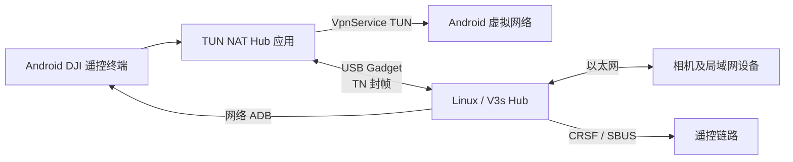
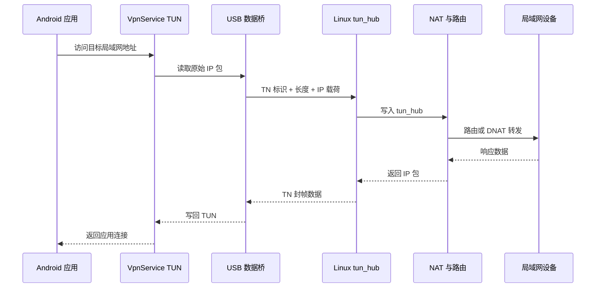
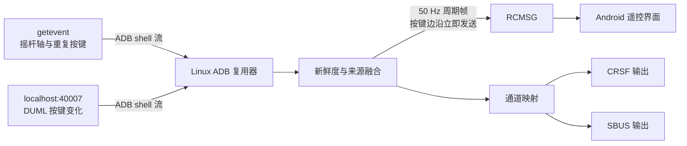

# TUN NAT Hub

[架构文档](docs/architecture.md) | [开始使用](docs/getting-started.md) | [通信协议](docs/protocol.md) | [故障排查](docs/troubleshooting.md)

TUN NAT Hub 用于连接 Android 遥控终端与 Linux/V3s USB 设备，并通过 Android `VpnService` 访问真实局域网。USB 链路承载封装后的 IP 数据；Linux 端还可通过网络 ADB 获取 DJI 遥控输入，将 `getevent` 摇杆轴与 `40007` 端口按键数据融合，再输出 RCMSG、CRSF 或 SBUS。

本项目是独立的社区项目，与 DJI、Google、GStreamer 及相关硬件厂商不存在隶属或背书关系。

## 系统架构



Android 负责 VPN、USB Host 和用户界面；Linux/V3s 负责 USB Gadget、TUN/NAT、网络 ADB 遥控采集、RC 输出及管理接口。完成首次授权后，两端服务可在界面关闭时持续运行。

## 网络链路



默认网络为 `192.168.144.0/24`：Android 使用 `.11`，Linux/V3s Hub 使用 `.66`，示例相机使用 `.31`。这些地址是可修改的产品默认值，不是设备凭据。零长度 `TN` 帧用于链路心跳。

## 遥控数据链路



在严格 `v3s_adb` 模式下，REC/SHOT 等重复信号由 `getevent` 负责，`40007` 提供其余按键和模式变化。摇杆状态按 50 Hz 周期输出，按键边沿可立即生成 RCMSG，以降低操作延迟并避免重复触发。

更完整的启动时序、模块关系和安全边界见[架构文档](docs/architecture.md)，帧格式与端口定义见[通信协议](docs/protocol.md)。

## 功能组成

- Android 应用：Kotlin、Jetpack Compose、`VpnService`、USB Host 和前台服务。
- Linux/V3s 服务：TUN 桥接、NAT 控制、网络 ADB 客户端、遥控融合及轻量 Web API。
- 双端共享的 `TN` 封帧格式及 RC 数据报文定义。
- 开机和 USB 接入自动启动，Activity 关闭后数据链路仍可持续运行。
- ADB 封包、RC 融合、来源选择、输入模式和 RTSP 辅助逻辑的主机单元测试。

## 仓库结构

| 路径 | 用途 |
| --- | --- |
| `android/` | Android 应用与测试 |
| `ubuntu/` | Linux/V3s C++ 服务、测试、服务配置和目标机脚本 |
| `protocol/` | 双端共享的线协议常量 |
| `docs/` | 架构、部署、协议和排障文档 |
| `scripts/` | 可重复构建与公开内容检查工具 |

本仓库不包含硬件设计、PCB 生产文件、固件/rootfs 镜像、APK、密钥、抓包和内部部署脚本。

## 快速构建

Android 侧需要 Android Studio 或 JDK 17、Android SDK/NDK/CMake；Linux 侧需要 CMake 3.16+ 和支持 C++17 的编译器。

```powershell
./scripts/build-android.ps1
```

Android 原生视频模块需要本地提供 GStreamer Android SDK 子集。将 `GSTREAMER_ROOT_ANDROID` 指向包含 `arm64/include` 和 `arm64/lib` 的目录，详见[开始使用](docs/getting-started.md)。

```sh
./scripts/build-linux.sh
```

Linux 主机构建会编译守护进程并运行现有单元测试。部署到设备时，还需要支持 USB Gadget 的内核，以及配置 TUN、路由和防火墙所需的 root 权限。

## 安全说明

本项目会使用 Android 和 Linux 的高权限能力。部署前应审查脚本、限制管理 API 的访问范围，并禁止提交 ADB 密钥或设备凭据。漏洞报告方式见 [SECURITY.md](SECURITY.md)。

## 开源许可

Copyright (C) 2026 TUN NAT Hub contributors.

本项目采用 GNU GPL v3.0 only。任何对外分发的修改版本都必须按同一许可证提供对应源码，详见 [LICENSE](LICENSE)。第三方组件继续适用其各自许可证，本仓库不分发 GStreamer Android SDK。
