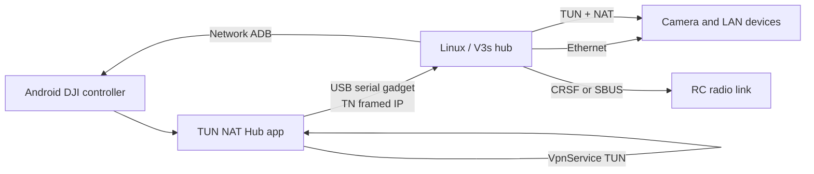
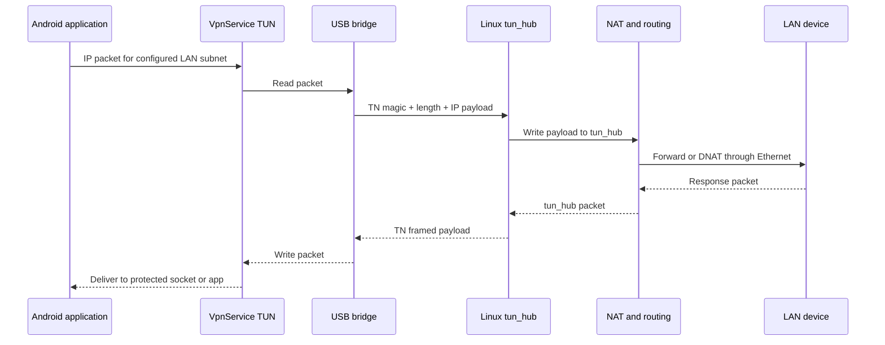
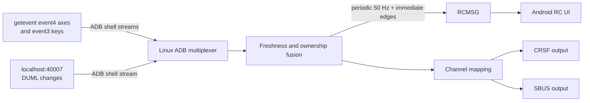
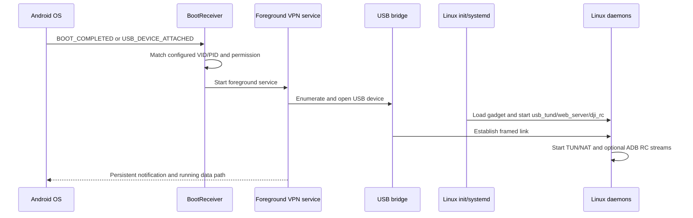
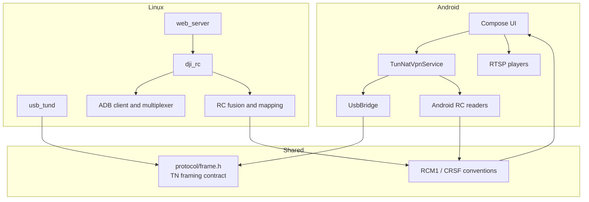

# Architecture

## System Overview

Android owns the user-facing VPN and USB host side. Linux owns USB gadget mode, packet forwarding, network ADB acquisition, RC output, and the management API. The components can run headlessly after startup.

## IP Packet Flow

Only the configured LAN subnet is routed into the VPN. Heartbeats use a zero-length `TN` frame, so link liveness does not require an IP packet.

## RC Input Flow

In strict `v3s_adb` mode, duplicated REC/SHOT signals are owned by `getevent`; `40007` supplies the remaining button and mode transitions. Button edges may trigger an immediate RCMSG while the periodic stream keeps axes and state refreshed.

## Startup Sequence

Android still requires the user to grant VPN consent and any required USB/accessibility/Shizuku permissions at least once. The receiver cannot silently bypass Android security prompts.

## Module Relationship

The shared C header is the canonical IP framing contract. RCMSG currently has mirrored Kotlin and C++ definitions; changes must update both sides and their tests in the same commit.

## Trust Boundaries

- USB connects two privileged endpoints; do not expose gadget nodes to untrusted local users.
- Network ADB grants shell-equivalent access to the target Android device and should be isolated to a trusted link.
- The Linux web API can alter networking and firmware state; bind or firewall it to a management network.
- NAT and forwarding rules affect the whole device. Test changes on recoverable hardware before production use.
